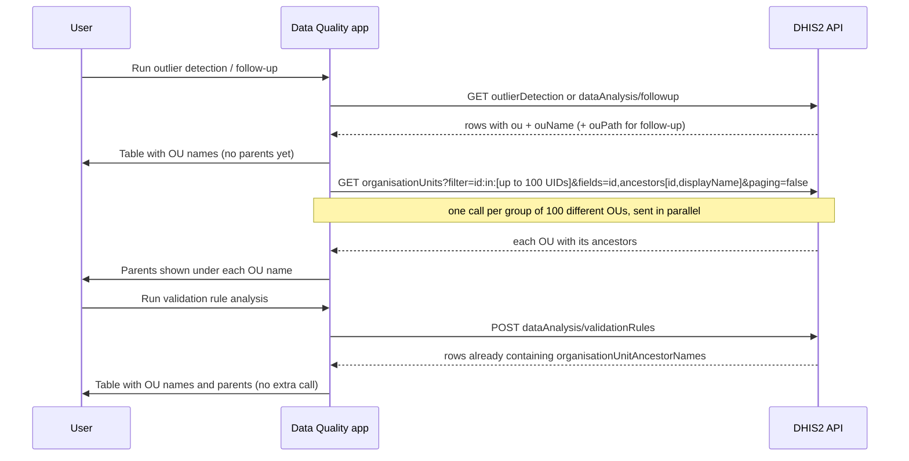

# Organisation unit hierarchy: modules, API calls and limitations

A companion to the spike findings in [organisation-unit-hierarchy-in-data-quality-analyses.md](./organisation-unit-hierarchy-in-data-quality-analyses.md). This guide explains, module by module:

-   which API calls the Data Quality app makes
-   what those calls return about the organisation unit (OU)
-   how the spike adds the OU's parent locations
-   the limitations of doing that in the client, and why a backend change is the better long-term fix

## Summary

| Module                   | Analysis call                                | Does the response include the OU's parents? | Extra call needed?                            |
| ------------------------ | -------------------------------------------- | ------------------------------------------- | --------------------------------------------- |
| Validation rule analysis | `POST /api/{v}/dataAnalysis/validationRules` | **Yes**: path + ancestor names              | **No**                                        |
| Outlier detection        | `GET /api/{v}/outlierDetection`              | **No**: only the OU's own id and name       | **Yes**: 1 to 5 calls to `organisationUnits`  |
| Follow-up analysis       | `GET /api/{v}/dataAnalysis/followup`         | **Partly**: path of ids, no names           | **Yes**: always 1 call to `organisationUnits` |

In all three modules the table now shows the parents under the OU name:

```
Ngelehun CHC
Sierra Leone / Bo / Badjia
```

`{v}` is the API version, e.g. `41`. app-runtime fills it in automatically from the server the app runs on.

The UIDs, names and values in the examples are illustrative, in the style of the Sierra Leone demo database. They are not captured from a live server.

---

## Module 1: Validation rule analysis

### The call

```
POST /api/{v}/dataAnalysis/validationRules
Content-Type: application/json

{
    "startDate": "2024-01-01",
    "endDate": "2024-12-31",
    "ou": "ImspTQPwCqd",
    "notification": false,
    "persist": false,
    "vrg": "<validation rule group id>"
}
```

-   `ou` is the **one** OU picked in the form. The analysis covers it and everything below it.
-   `vrg` is only sent when a specific validation rule group is selected.
-   The server returns at most 500 results by default (`ValidationService.MAX_INTERACTIVE_ALERTS`, also capped by the `keyDataQualityMaxLimit` system setting, default 500).

### What it returns about the OU

The response is an array of validation violations. Each contains:

```json
{
    "organisationUnitId": "DiszpKrYNg8",
    "organisationUnitDisplayName": "Ngelehun CHC",
    "organisationUnitPath": "/ImspTQPwCqd/O6uvpzGd5pu/YuQRtpLP10I/DiszpKrYNg8",
    "organisationUnitAncestorNames": "Sierra Leone / Bo / Badjia / "
}
```

| Field                           | Meaning                                                                                                        |
| ------------------------------- | -------------------------------------------------------------------------------------------------------------- |
| `organisationUnitId`            | The OU's UID (11 characters)                                                                                   |
| `organisationUnitDisplayName`   | The OU's name, translated if a translation exists                                                              |
| `organisationUnitPath`          | UIDs from the root down to this OU, separated by `/`                                                           |
| `organisationUnitAncestorNames` | Names of all parents, root first, each followed by `" / "`. Doesn't include the OU itself. Empty for the root. |

These two hierarchy fields were always in the response. The app just didn't use them before.

### How the spike uses it

`parseAncestorNames` in `src/helpers/org-unit-hierarchy.js` turns the names into a list and checks it against the path:

-   The path `/ImspTQPwCqd/O6uvpzGd5pu/YuQRtpLP10I/DiszpKrYNg8` has 4 levels, so there must be exactly 3 parent names.
-   3 names gives `["Sierra Leone", "Bo", "Badjia"]`, which is shown.
-   Fewer names than expected means a parent is missing. The cell shows _Hierarchy unavailable_ instead of an incomplete path.
-   More names than expected means an OU name itself contains `" / "`. The text is shown as one unsplit piece, so it still reads correctly.

**No extra API call is made for this module.**

---

## Module 2: Outlier detection

### The call

```
GET /api/{v}/outlierDetection
    ?ds=BfMAe6Itzgt,QX4ZTUbOt3a
    &ou=ImspTQPwCqd,O6uvpzGd5pu
    &startDate=2024-01-01
    &endDate=2024-12-31
    &algorithm=Z_SCORE
    &maxResults=500
    &orderBy=MEAN_ABS_DEV
    &threshold=3
```

-   `ou` can be **several** OUs; the form allows multiple selection.
-   `maxResults` is chosen in the form: 100, 200 or 500 (default 500).
-   `threshold`, `dataStartDate` and `dataEndDate` are only sent for the Z-score algorithms.

### What it returns about the OU

```json
{
    "outlierValues": [
        {
            "de": "fbfJHSPpUQD",
            "deName": "ANC 1st visit",
            "pe": "202401",
            "ou": "DiszpKrYNg8",
            "ouName": "Ngelehun CHC",
            "value": 120,
            "zScore": 3.4
        }
    ]
}
```

The rest of each row (`coc`, `aoc`, `mean`, `stdDev`, `absDev`, `lowerBound`, `upperBound`, `followup`, …) is about the value, not the OU.

| Field    | Meaning                                         |
| -------- | ----------------------------------------------- |
| `ou`     | The OU's UID                                    |
| `ouName` | The OU's name (database `name`, not translated) |

There is **no path and no parent information**. The server's SQL selects `ou.name` but not `ou.path`. So on its own the app cannot know where `Ngelehun CHC` sits in the hierarchy.

### How the spike fills the gap

`OutlierAnalysisTable` collects the `ou` of every row and makes the **OU lookup call** described [below](#the-ou-lookup-call). Typically that's 1–2 calls, never more than 5.

---

## Module 3: Follow-up analysis

### The call

```
GET /api/{v}/dataAnalysis/followup
    ?startDate=2024-01-01
    &endDate=2024-12-31
    &ou=ImspTQPwCqd
    &ds=BfMAe6Itzgt
```

-   `ou` is **one** OU.
-   The app doesn't send `maxResults`, so the server uses its default of **50 rows** (`FollowupAnalysisRequest.maxResults = 50`).

### What it returns about the OU

```json
{
    "followupValues": [
        {
            "de": "fbfJHSPpUQD",
            "deName": "ANC 1st visit",
            "pe": "202401",
            "peName": "January 2024",
            "ou": "DiszpKrYNg8",
            "ouName": "Ngelehun CHC",
            "ouPath": "/ImspTQPwCqd/O6uvpzGd5pu/YuQRtpLP10I/DiszpKrYNg8",
            "value": "120",
            "comment": "Checked with facility"
        }
    ]
}
```

| Field    | Meaning                                                |
| -------- | ------------------------------------------------------ |
| `ou`     | The OU's UID (the app renames it `organisationUnitId`) |
| `ouName` | The OU's name (not translated)                         |
| `ouPath` | UIDs from the root down to this OU, **but no names**   |

`ouPath` says _which_ parents the OU has (`ImspTQPwCqd`, `O6uvpzGd5pu`, …), but not what they are called. Showing `ImspTQPwCqd / O6uvpzGd5pu / YuQRtpLP10I` would mean nothing to users, so the names still have to be looked up.

### How the spike fills the gap

`FollowUpAnalysisTable` collects the `organisationUnitId` of every row and makes the same **OU lookup call** as outlier detection. With at most 50 rows there are at most 50 different OUs, so this is **always exactly 1 call**.

The spike doesn't use `ouPath`. Using it is a possible optimisation, see [Limitations](#limitations).

---

## The OU lookup call

Used by outlier detection and follow-up analysis only.

```
GET /api/{v}/organisationUnits?filter=id:in:[DiszpKrYNg8,ImspTQPwCqd]&fields=id,ancestors[id,displayName]&paging=false
```

### Each part

| Part                         | What it does                                                                            |
| ---------------------------- | --------------------------------------------------------------------------------------- |
| `/api/{v}/organisationUnits` | The standard metadata endpoint listing organisation units                               |
| `filter=id:in:[…]`           | Return only the OUs whose UID is in this list. The format is `property:operator:value`. |
| `fields=id,ancestors[…]`     | Return only the OU's UID and its list of parents, nothing else                          |
| `ancestors[id,displayName]`  | For each parent, return only its UID and name                                           |
| `paging=false`               | Return all matches in one response. Without it the server returns only the first 50.    |

### The three `id`s in the URL

| Where                               | Refers to                  | Why it's there                                                                                                        |
| ----------------------------------- | -------------------------- | --------------------------------------------------------------------------------------------------------------------- |
| `filter=`**`id`**`:in:[…]`          | The OUs we're asking about | Selects which OUs to fetch. The UIDs come from the analysis rows.                                                     |
| `fields=`**`id`**`,ancestors…`      | Each returned OU's own UID | Lets the app match each answer back to its table rows. Response order isn't guaranteed, and missing OUs are left out. |
| `ancestors[`**`id`**`,displayName]` | Each parent's UID          | Returned but not used by the UI yet. It could be removed, or used later for links.                                    |

### What it returns

```json
{
    "organisationUnits": [
        {
            "id": "DiszpKrYNg8",
            "ancestors": [
                { "id": "ImspTQPwCqd", "displayName": "Sierra Leone" },
                { "id": "O6uvpzGd5pu", "displayName": "Bo" },
                { "id": "YuQRtpLP10I", "displayName": "Badjia" }
            ]
        },
        { "id": "ImspTQPwCqd", "ancestors": [] }
    ]
}
```

-   `ancestors` is ordered **root first** and **doesn't include the OU itself**, so it never repeats the name already shown in the table.
-   A root OU has an empty `ancestors` list.
-   `displayName` is translated into the user's language when a translation exists.
-   A UID that doesn't exist (e.g. a deleted OU) is simply missing from the list. There is no error.

### How the server handles it

Based on the dhis2-core source:

1. **Permission check.** Org units have no read authority, so any logged-in user can read them.
2. **No hierarchy restriction.** The lookup isn't limited to the user's own OUs. That's fine here, because the UIDs come from the user's own analysis results.
3. **Filter.** `id:in:[…]` becomes roughly `WHERE uid IN (…)` in SQL.
4. **Ancestors.** For each OU the server follows `parent` → `parent` → … up to the root, then reverses the list.

### How the app matches the answer to rows

```js
// after the call
{ DiszpKrYNg8: ["Sierra Leone", "Bo", "Badjia"], ImspTQPwCqd: [] }

// each table row looks up its own OU
ancestorsById[row.ou]                   // outlier detection
ancestorsById[row.organisationUnitId]   // follow-up analysis
```

---

## How many lookup calls are made

**Each call carries up to 100 OU UIDs. It is never one call per row or per OU.**

1. **Remove duplicates.** Many rows can belong to the same OU. 500 outlier rows might involve only 180 different OUs.
2. **Split into groups of up to 100 UIDs.** 180 OUs becomes one group of 100 and one of 80.
3. **Send one call per group, at the same time.** That's 2 calls in total.

| Different OUs in the results | Lookup calls |
| ---------------------------- | ------------ |
| 0 (validation rules)         | 0            |
| 1–100                        | 1            |
| 101–200                      | 2            |
| 201–300                      | 3            |
| 301–400                      | 4            |
| 401–500                      | 5 (maximum)  |

| Module            | Max rows | Max lookup calls |
| ----------------- | -------- | ---------------- |
| Validation rules  | 500      | 0                |
| Outlier detection | 500      | 5                |
| Follow-up         | 50       | 1                |

**Why 100 per call?** The UIDs go into the URL, and many servers reject URLs over about 8,000 characters. Each UID takes about 14 characters once URL-encoded (`,` becomes `%2C`, and so on):

-   500 UIDs in one call is about 7,000 characters, dangerously close to the limit.
-   100 UIDs is about 1,400 characters, which is safe.

**When calls are not repeated:**

-   Ticking follow-up checkboxes or unfollowing rows doesn't trigger a new lookup. The table remembers which OUs it has already asked about.
-   Running a **new** analysis does look them up again. There is no cache across analyses yet.

---

## End-to-end flow



---

## What the user sees

| Situation                                 | Cell shows                                                  |
| ----------------------------------------- | ----------------------------------------------------------- |
| Parents found                             | `Ngelehun CHC` with `Sierra Leone / Bo / Badjia` underneath |
| The OU is the root (e.g. the country)     | Name only, since it has no parents                          |
| Lookup still loading                      | Name only, briefly                                          |
| OU missing from the lookup response       | Name with _Hierarchy unavailable_ underneath                |
| Lookup call failed (network, 401, 500)    | Name with _Hierarchy unavailable_ for every OU in that call |
| Validation rules: parent names incomplete | Name with _Hierarchy unavailable_ underneath                |

The finding itself (values, checkboxes, details) always shows, even when the hierarchy doesn't. Hovering over the cell shows the full path, e.g. `Sierra Leone / Bo / Badjia / Ngelehun CHC`.

---

## Limitations

1. **Extra network calls for two of the three modules.** The parents appear a moment after the table, because they arrive in a second request.
2. **Downloads are not covered.** The CSV/PDF/XLS downloads are produced by the server, so the client-side lookup can't add parents to them.
3. **Mixed languages are possible.**
    - Outlier and follow-up OU names (`ouName`) and validation ancestor names use the untranslated `name`.
    - The lookup returns translated `displayName`.
    - In a database with translated OU names, one cell could mix languages.
4. **Server cost of `ancestors` is unmeasured.** The server walks up the parent chain for each OU. That's expected to be cheap, but it hasn't been tested on a very large database.
5. **No cache across analyses.** Running another analysis repeats the lookup.
6. **Follow-up doesn't use the `ouPath` it already has.** Using it would allow asking only for the names of the distinct parents, which is fewer and lighter than the full ancestors of every OU.
7. **Follow-up returns at most 50 rows.** This is a pre-existing behaviour, not caused by the spike. The app's "more than 500 values" warning (`apiConf.results.analysis.limit = 500`) can therefore never appear on the follow-up page, so users may not realise results were cut off at 50.
8. **Not tested against a live DHIS2 server.** Behaviour is based on the dhis2-core source, the 2.42 OpenAPI spec and unit tests. No screenshots yet.
9. **Right-to-left languages.** The `" / "`-joined path hasn't been checked in Arabic, Urdu, etc.

---

## Why the backend should provide this

The client-side lookup works, and it's the only option for DHIS2 versions already released. But it is a workaround:

-   **The server already has the data.** Each analysis query already reads the OU table. Validation rule analysis already returns the parent names; outlier detection and follow-up could do the same at almost no cost.
-   **Downloads need it.** Only the server can put the hierarchy into CSV/PDF/XLS downloads, which national users rely on for sharing and further analysis.
-   **Other API users benefit.** Scripts, integrations and other apps calling these endpoints would get the hierarchy too.
-   **Fewer moving parts.** With the server providing it, all three modules would read the hierarchy straight from their own response: no extra calls, no batching, no loading state, no language mismatch.

### Suggested backend change (dhis2-core)

| Endpoint                | Change                                                                                                             |
| ----------------------- | ------------------------------------------------------------------------------------------------------------------ |
| `outlierDetection`      | Select `ou.path` in the outlier SQL (`*SqlStatementProcessor`). Add `ouPath` and ancestor names to `OutlierValue`. |
| `dataAnalysis/followup` | `ouPath` is already there. Add ancestor names to `FollowupValue`.                                                  |
| Downloads               | Include the hierarchy (or a "Parent hierarchy" column) in the CSV/PDF/XLS outputs.                                 |

Validation rule analysis already returns what is needed and only needs the download change.

### Recommended approach

1. **Backend:** add the hierarchy fields above. This is a small, self-contained change for the core team.
2. **App:**
    - Read the hierarchy from the analysis response whenever the server provides it.
    - Keep the batched lookup only as a **fallback** for older servers. The app supports DHIS2 2.38 and later, and those versions won't receive the backend change.
    - Remove the fallback once the app's minimum supported DHIS2 version includes the backend change.

---

## Verification status

| Statement                                                     | How it was checked                                                |
| ------------------------------------------------------------- | ----------------------------------------------------------------- |
| Response fields of the three analyses                         | dhis2-core source (`master` @ `1bb056fede`) and 2.42 OpenAPI spec |
| `organisationUnitAncestorNames` and `ouPath` exist since 2.37 | dhis2-core git history                                            |
| Follow-up default of 50 rows, validation default of 500       | dhis2-core source                                                 |
| `paging=false` keeps the lookup on the standard metadata path | dhis2-core source (`GistBridge`)                                  |
| App behaviour (batching, deduplication, fallbacks)            | Unit tests in this PR (25 passing)                                |
| Real responses, timings, screenshots                          | **Not verified**: needs a live DHIS2 instance                     |
