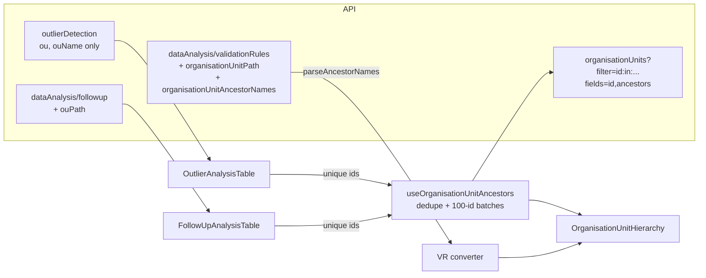

# Spike: Organisation unit hierarchy in data quality analyses

Status: spike / proof of concept. Not production-ready; see [Spike code vs production work](#18-recommended-next-step).

For a plain-language walkthrough of each module's API calls, the OU lookup and the case for a backend change, see [organisation-unit-hierarchy-api-guide.md](./organisation-unit-hierarchy-api-guide.md).

## 1. Problem statement and scope

The validation rule, outlier detection and follow-up analysis result tables show only the organisation unit (OU) name, e.g. `Ngelehun CHC`. Facility names repeat across districts and are often not unique, so national and regional users cannot tell where a finding is without leaving the app.

Scope of the spike:

-   Find what hierarchy data each analysis already returns and what must be fetched.
-   Compare data-fetching and UI approaches.
-   Build a minimal proof of concept that works on all three pages.
-   Out of scope: backend changes, CSV/PDF/XLS exports, the OU tree in the forms.

## 2. Existing architecture and data flow

All three pages follow the same pattern, but share no table, row or data-model code:

| Page               | Request                                                 | Converter                                                      | Row component                                 | OU name field                 | OU id field          |
| ------------------ | ------------------------------------------------------- | -------------------------------------------------------------- | --------------------------------------------- | ----------------------------- | -------------------- |
| Validation rules   | `POST dataAnalysis/validationRules` (`useDataMutation`) | `ValidationRulesAnalysis/convert-element-from-api-response.js` | `ValidationRulesAnalysisTable/ElementRow.jsx` | `organisationUnitDisplayName` | `organisationUnitId` |
| Outlier detection  | `GET outlierDetection` (`useDataQuery`, lazy)           | `OutlierDetection/convert-element-from-api-response.js`        | `OutlierAnalysisTable/ElementRow.jsx`         | `ouName`                      | `ou`                 |
| Follow-up analysis | `GET dataAnalysis/followup` (`useDataQuery`, lazy)      | `FollowUpAnalysis/convert-element-from-api-response.js`        | `FollowUpAnalysisTable/ElementRow.jsx`        | `ouName`                      | `ou`                 |

Flow: form → request → `onComplete` maps the response through the page's converter into `elements` state → `<XTable elements>` → one `<ElementRow>` per element, rendered in a `material-ui` 0.x `Table`.

Other relevant facts:

-   No OU metadata or hierarchy is cached anywhere in the app. `AvailableOrganisationUnitsTree` uses the `@dhis2/ui` `OrganisationUnitTree` for input only.
-   Every result row already carries the OU UID, which is the stable join key.
-   Results are capped per analysis:
    -   Validation rules: 500 by default (`ValidationService.MAX_INTERACTIVE_ALERTS`, also limited by the `keyDataQualityMaxLimit` system setting).
    -   Outliers: the form offers 100/200/500.
    -   Follow-up: **50**. The app doesn't send `maxResults`, so the server default in `FollowupAnalysisRequest` applies. The app's 500-row warning (`apiConf.results.analysis.limit`) can therefore never show on that page; this is pre-existing and not caused by the spike.
-   Existing cells use the HTML `title` attribute to show full values on hover.
-   Tests: Jest via `d2-app-scripts test` (jsdom). Before this spike there was only one spec file and no `@testing-library` dependency.

## 3. Findings per analysis

### Validation rules: hierarchy already in the response

`ValidationResultView` (dhis2-core `DataAnalysisController#validationResultsListToResponse`) sets:

-   `organisationUnitPath`, from `OrganisationUnit#getStoredPath()`, e.g. `/ImspTQPwCqd/O6uvpzGd5pu/YuQRtpLP10I/DiszpKrYNg8`
-   `organisationUnitAncestorNames`, from `OrganisationUnit#getAncestorNames()`: ancestor `name`s, root first, each followed by `" / "`, e.g. `Sierra Leone / Bo / Badjia / `. It excludes the OU itself and is an empty string for a root OU.

The app ignored both fields. **No extra request is needed.**

### Follow-up analysis: path in the response, names are not

`FollowupValue` has `ouPath` (selected as `ou.path` in `FollowupValueManager`), present since 2.37 (DHIS2-10658). It contains ancestor UIDs but not names, so names need one batched metadata request.

### Outlier detection: no hierarchy data

`OutlierValue` returns only `ou` and `ouName`. The SQL in `*SqlStatementProcessor` selects `ou.name` but not `ou.path`. Names need one batched metadata request, unless the backend adds the path.

## 4. DHIS2 API support and relevant fields

| Field / capability                                      | Where                                                                          | Source of truth                          |
| ------------------------------------------------------- | ------------------------------------------------------------------------------ | ---------------------------------------- |
| `organisationUnitPath`, `organisationUnitAncestorNames` | `dataAnalysis/validationRules` response                                        | Analysis API (direct)                    |
| `ouPath`                                                | `dataAnalysis/followup` response                                               | Analysis API (direct)                    |
| OU path / ancestors for outliers                        | not available                                                                  | Needs metadata request or backend change |
| `path`, `level`, `parent`, `ancestors`, `displayName`   | `GET /api/organisationUnits` with `fields=`                                    | Metadata API (separate request)          |
| `filter=id:in:[a,b,…]` batch filter                     | `GET /api/organisationUnits`                                                   | Metadata API                             |
| Read authority for org units                            | `OrganisationUnitSchemaDescriptor` declares only CREATE and DELETE authorities | No special authority needed to read      |

`ancestors` is a `@JsonProperty` on `OrganisationUnit`, ordered root first and excluding the OU itself, so `fields=id,ancestors[id,displayName]` returns everything needed in one request.

## 5. Evidence: verified vs assumed

**Verified by reading source and specs:**

-   DTO fields: dhis2-core `master` at `1bb056fede` (2026-09-11) and the generated OpenAPI spec for 2.42 (`dhis2-open-api-ts/openapi-dhis2-2-42.json`).
-   `organisationUnitAncestorNames` and `ouPath`: in tags from `2.37.0` onward, which covers the app's `minDHIS2Version` of 2.38.
-   app-runtime 3.14.5 encodes string params with `encodeURIComponent`. A comma becomes `%2C`, so an 11-character UID costs about 14 URL characters.
-   The proof of concept's behaviour, verified with hand-written fixtures in Jest. See section 15.

**Not verified (no live instance was used):**

-   Requests to a live DHIS2 server were not made during the spike, so no response was observed directly.
-   Whether `fields=ancestors[id,displayName]` serialises exactly as expected on every supported version (2.38+). Source and OpenAPI suggest it does.
-   The server-side cost of computing `ancestors` for 500 OUs. It walks the parent chain per OU.
-   Visual rendering in the app. No screenshots were taken.
-   Org unit reads with restricted users, e.g. users whose search or capture roots don't include an OU.

## 6. Implementation options and trade-offs

| Option                                                    | Requests                                         | Pages                      | Complexity | Backend change                    | Notes                                                                                                                                                   |
| --------------------------------------------------------- | ------------------------------------------------ | -------------------------- | ---------- | --------------------------------- | ------------------------------------------------------------------------------------------------------------------------------------------------------- |
| **A. Use path/names from the analysis response**          | 0                                                | VR (names), FU (path only) | Low        | No (VR, FU); **yes** for outliers | Free for VR. FU still needs names. Ancestor names use `name`, not `displayName`, so they are not translated.                                            |
| **B. Join OU metadata by id (batched)**                   | ⌈unique OUs / 100⌉, max 5 at 500 rows            | All three                  | Low–medium | No                                | One generic hook. Translated `displayName`. Server computes `ancestors`.                                                                                |
| **C. Fetch ancestor UIDs from paths, then names**         | 1 for FU (path known); 2 sequential for outliers | FU, outliers               | Medium     | No                                | Smaller payload: unique ancestors are usually far fewer than unique OUs. Cheaper server query (`fields=id,displayName`). Extra round trip for outliers. |
| **D. Existing hierarchy utility or cache**                | –                                                | –                          | –          | –                                 | **Not viable:** nothing exists in the app. `OrganisationUnitTree` fetches its own data and exposes no cache.                                            |
| E. Backend: add `ouPath`/ancestor names to `OutlierValue` | 0                                                | Outliers                   | Low (core) | **Yes**                           | Best long-term. Needs a dhis2-core release and would not reach older supported versions.                                                                |

Notes on B and C:

-   **Batching:** 100 UIDs per request is about 1.4 KB of filter, well under typical 8 KB request-line or header limits in nginx and Jetty. 500 UIDs in one request would be about 7 KB, which is too close to those limits.
-   **Payload (rough estimate, not measured):** about 50–60 bytes per ancestor. 500 distinct facilities at depth 4 is about 100–150 KB uncompressed for B and much less for C.
-   **Missing or inaccessible metadata:** an OU absent from the response becomes `null`, shown as "Hierarchy unavailable". A failed request does the same for every requested OU. The finding still renders.

## 7. Recommended UI pattern

Four patterns were compared:

| Pattern                                                    | Pros                                                                              | Cons                                                                                               |
| ---------------------------------------------------------- | --------------------------------------------------------------------------------- | -------------------------------------------------------------------------------------------------- |
| 1. Secondary text under the name                           | Always visible, scannable, works with screen readers and keyboard, no interaction | Taller rows; long paths wrap                                                                       |
| 2. Tooltip or popover only                                 | No density cost                                                                   | Not discoverable; hover-only `title` is not keyboard accessible; can't compare rows at a glance    |
| 3. Expandable row or detail panel                          | Room for level names or links                                                     | `material-ui` 0.x `Table` has no expandable rows; one click per finding; heavy for a 500-row table |
| 4. **Hybrid: secondary text + `title` with the full path** | Pattern 1 plus the app's existing `title` convention for clipped cells            | Minor redundancy                                                                                   |

**Recommendation: pattern 4 (hybrid).**

-   The OU name stays the primary, unchanged line.
-   The ancestors (`Sierra Leone / Bo / Badjia`) appear underneath in 12 px `grey700`, wrapping where needed.
-   The cell's `title` holds the full path including the OU, matching how the other cells already expose full values.
-   Root OUs show only the name; there is nothing to add. The OU's own name is never repeated in the secondary line.
-   Separator is `" / "`, the same one DHIS2 uses in `getAncestorNames`. Level names are not hard-coded.

## 8. Example data flow

Outlier detection (option B):

1. `outlierDetection` returns 500 rows covering 180 distinct OUs.
2. `OutlierAnalysisTable` calls `useOrganisationUnitAncestors(elements.map(e => e.ou))`.
3. The hook dedupes the 180 ids and sends 2 parallel requests (100 + 80):
   `GET /api/organisationUnits?filter=id:in:[…]&fields=id,ancestors[id,displayName]&paging=false`
4. Results are merged into `{ [ouId]: string[] | null }`. Requested ids missing from the response become `null`.
5. `ElementRow` passes `ancestorsById[element.ou]` to `<OrganisationUnitHierarchy>`.
6. Marking for follow-up or unfollowing changes `elements` but not the set of ids, so no new request is made.

## 9. Architecture diagram



## 10. Example input and output

Validation rule result (input):

```json
{
    "organisationUnitId": "DiszpKrYNg8",
    "organisationUnitDisplayName": "Ngelehun CHC",
    "organisationUnitPath": "/ImspTQPwCqd/O6uvpzGd5pu/YuQRtpLP10I/DiszpKrYNg8",
    "organisationUnitAncestorNames": "Sierra Leone / Bo / Badjia / "
}
```

`parseAncestorNames` output:

| Input case                            | Output                                                                                         |
| ------------------------------------- | ---------------------------------------------------------------------------------------------- |
| Complete (above)                      | `["Sierra Leone", "Bo", "Badjia"]`                                                             |
| Root: path `/ImspTQPwCqd`, names `""` | `[]` → name only                                                                               |
| Missing parent: 3-level path, 2 names | `null` → "Hierarchy unavailable"                                                               |
| An ancestor named `Rural / Urban`     | `["Sierra Leone / Western Area / Rural / Urban"]` (single unsplit segment; displays correctly) |
| Fields absent                         | `null`                                                                                         |

Metadata response for outliers and follow-up:

```json
{
    "organisationUnits": [
        {
            "id": "DiszpKrYNg8",
            "ancestors": [
                { "id": "ImspTQPwCqd", "displayName": "Sierra Leone" },
                { "id": "O6uvpzGd5pu", "displayName": "Bo" },
                { "id": "YuQRtpLP10I", "displayName": "Badjia" }
            ]
        },
        { "id": "ImspTQPwCqd", "ancestors": [] }
    ]
}
```

Rendered cell:

```
Ngelehun CHC
Sierra Leone / Bo / Badjia          ← 12px grey secondary text
title="Sierra Leone / Bo / Badjia / Ngelehun CHC"
```

These examples are hand-written fixtures based on the DTOs, not captured API responses.

## 11. Performance considerations

-   **Request count:**
    -   Validation rules: 0 extra requests.
    -   Outliers: ⌈unique OUs / 100⌉ requests in parallel, at most 5 at the 500-row cap.
    -   Follow-up: always 1 request, because of the 50-row cap.
    -   Never one request per row: each request carries up to 100 OU UIDs.
-   **Deduplication:** ids are deduplicated before batching. Per mounted table, each id is requested at most once, so toggling follow-up or unfollowing rows triggers no new requests.
-   **Caching across pages:** not done in the spike. Running a new analysis remounts the table and refetches. Two options for production:

    1. A module-level `Map` of `ouId → ancestors` shared by all pages, simplest.
    2. app-runtime `useDataQuery` per chunk, which uses its react-query cache keyed by query and variables. This is awkward with a dynamic number of chunks.

    Hierarchy changes rarely, so a session-lifetime cache is acceptable.

-   **Large result sets:** bounded by the 500-row cap. Rendering cost is one extra `<span>` per row.
-   **Server cost:** `ancestors` is computed per OU by walking `parent`. Repeated parents are shared within a request, but this was not measured. If it is slow on large databases (for example 100k+ OUs), switch to option C.

## 12. Error handling and incomplete metadata

| Situation                             | Display                                                  |
| ------------------------------------- | -------------------------------------------------------- |
| Loading                               | Name only (no flicker of "unavailable")                  |
| Root OU                               | Name only                                                |
| OU absent from metadata response      | Name + _Hierarchy unavailable_ (italic)                  |
| Metadata request fails (any chunk)    | Name + _Hierarchy unavailable_ for every OU in that call |
| VR names inconsistent with path depth | Name + _Hierarchy unavailable_                           |

A path is never shown unless it is known to be complete. The finding row, actions and the existing name never depend on the hierarchy.

For production, a total failure should probably show one page-level `NoticeBox` instead of 500 repeated cell messages.

## 13. Backend/API changes required

None are needed for the proof of concept, but a backend change is **recommended** as the long-term solution. The client-side join should only be a fallback for older servers.

-   **Outliers:** select `ou.path` in the three `*SqlStatementProcessor`s, map it in `AbstractOutlierDetectionManager`, and add `ouPath` plus ancestor names to `OutlierValue`.
-   **Follow-up:** add ancestor names to `FollowupValue`; `ouPath` is already there.
-   **Downloads:** include the hierarchy in the CSV/PDF/XLS outputs. A client-side join can never add it there.

Why: the server already reads the OU table during each analysis, validation rules already returns ancestor names, and other API users would benefit too. New fields only reach new core versions, so the app keeps the client-side join as a fallback until its minimum supported DHIS2 version includes them. See [Why the backend should provide this](./organisation-unit-hierarchy-api-guide.md#why-the-backend-should-provide-this).

## 14. Accessibility and localisation

-   The hierarchy is real text in the cell, so screen readers announce it and keyboard users can see it. No interaction is required.
-   `title` is a convenience only; it isn't keyboard or touch accessible. That's why the path is shown inline, not only in the `title`.
-   `grey700` (`#4a5768`) on white has a contrast ratio of 7.36:1, computed from the installed `@dhis2/ui-constants`. That passes WCAG AA for 12 px text. It was not measured in the rendered app.
-   New string: `Hierarchy unavailable`. It was added to `i18n/en.pot` by the build.
-   **Name language mismatch:**

    -   Validation `organisationUnitAncestorNames` uses `name`, so it is not translated.
    -   The metadata join uses `displayName`, which is translated.
    -   Outlier and follow-up `ouName` also use `name`.

    In databases with translated OU names, a row could mix languages. Production should pick one consistently: fetch `name` throughout, or use the hook for validation rules too.

-   **RTL:** the `" / "` separator is joined as plain text. In RTL locales (ar, ur, ps, prs, ckb), mixed-direction names may reorder. Production should wrap segments in `<bdi>` and check this visually.

## 15. Tests executed and results

All commands were run locally on this branch:

| Check                                             | Before spike            | After spike                                                                                 |
| ------------------------------------------------- | ----------------------- | ------------------------------------------------------------------------------------------- |
| `yarn test --watchAll=false`                      | 1 suite, 3 tests passed | **5 suites, 25 tests passed**; no console warnings                                          |
| `yarn lint` (ESLint + Prettier for JS, CSS, text) | 0 errors, 3 warnings    | 0 errors, same 3 warnings; all files formatted                                              |
| `yarn build`                                      | not run                 | **Succeeded**; produced `data-quality-100.0.1.zip`. The chunk-size warning is pre-existing. |

The 3 lint warnings are pre-existing: `react-hooks/exhaustive-deps` in `App.jsx` and `AvailableOrganisationUnitsTree.jsx`, and an ignored file `src/locales/index.js`.

New tests:

-   `src/helpers/org-unit-hierarchy.spec.js`: path parsing (complete, root, missing parent, separator in name, missing fields), formatting, chunking, batched fetch (dedupe, request shape, missing OU, multiple branches, 250 ids → 3 requests, failure).
-   `src/components/OrganisationUnitHierarchy/OrganisationUnitHierarchy.spec.jsx`: full path, root, loading, unavailable.
-   `src/components/OrganisationUnitHierarchy/use-organisation-unit-ancestors.spec.jsx`: with `CustomDataProvider`, checks one request for 5 rows / 4 OUs, missing OU → `null`, no refetch when rows are removed, failure → all `null`.
-   `src/pages/ValidationRulesAnalysis/convert-element-from-api-response.spec.js`: converter keeps the name and adds ancestors.

Fixtures are in `src/helpers/__fixtures__/org-unit-hierarchy.js`.

## 16. Limitations and manual verification required

-   **Not run against a live DHIS2 instance.** No screenshots. Manual checks needed on a 2.38 and a current instance:
    -   [ ] Each page shows the correct path for facility-level, district-level and root findings.
    -   [ ] Network tab shows ≤ 5 `organisationUnits` requests for a 500-row outlier result and none for validation rules.
    -   [ ] `fields=id,ancestors[id,displayName]` returns the expected shape on 2.38.
    -   [ ] Response time of the ancestors request on a large database.
    -   [ ] Translated OU names and an RTL locale.
    -   [ ] Narrow viewport: wrapping in the outlier column (20% width) and the validation cell (`max-height: 64px` may clip paths of 3+ lines; `title` remains as fallback).
-   Exports (CSV/PDF/XLS) are generated server-side and still contain only the OU name.
-   No cache across analyses (see section 11).
-   Follow-up ignores `ouPath` and uses the same hook as outliers, for simplicity. Option C would use it.

## 17. Estimated implementation effort (preliminary)

These are **preliminary engineering estimates**, assuming the spike code is used as a starting point. Uncertainty is mainly server performance of `ancestors` and design review.

| Work item                                                                                        | Estimate             | Notes                                                         |
| ------------------------------------------------------------------------------------------------ | -------------------- | ------------------------------------------------------------- |
| Shared: component, helper, hook, session cache, page-level error notice, tests, design/UX review | 2–3 days             | Shared by all pages                                           |
| Validation rules page                                                                            | 0.5 day              | Response already has the data; decide `name` vs `displayName` |
| Follow-up analysis page                                                                          | 0.5–1 day            | Possibly switch to option C using `ouPath`                    |
| Outlier detection page                                                                           | 1–1.5 days           | Includes performance check on a large DB                      |
| QA on 2.38 + latest, RTL, narrow viewport                                                        | 1 day                |                                                               |
| Recommended backend: hierarchy fields in outlier/follow-up responses and downloads               | 2–3 days (core team) | Separate story; doesn't block the app work                    |

Total for the app: about 5–7 days.

## 18. Recommended next step

Create a **production implementation story**:

> Show the organisation unit hierarchy in validation rule, outlier and follow-up results. Use the hierarchy returned by the API where available (validation rules), and a batched, deduplicated, session-cached `organisationUnits` join (outlier, follow-up) otherwise. Display the ancestors as secondary text under the OU name, with the full path in the cell title.

Acceptance criteria:

-   Root and unavailable handling as in section 12.
-   No per-row requests.
-   One page-level message on total failure.
-   `<bdi>` segments for RTL.
-   Tests as in section 15.

Plus a recommended story for the core team: add hierarchy fields to the outlier and follow-up responses and to the downloads (section 13). The app then reads them directly and keeps the client-side join only for older servers.

### Spike code vs production work

The spike code is a working vertical slice on all three pages.

**Production-ready as-is:** the pure helpers and their tests.

**Needs production work:**

-   Session cache in the hook.
-   Page-level error notice.
-   `<bdi>` and RTL check.
-   `name` vs `displayName` consistency.
-   Manual verification and screenshots on a live instance.
-   Design sign-off on the secondary-text style.
