# Control data quality { #control_data_quality } 

## About data quality checks { #about_data_quality } 

The **Data Quality** app contains tools to validate the accuracy and
reliability of the data in the system. You can assess different dimensions of 
data quality as outlined in the following table: 

| Dimension | Description |
|---|---|
| Correctness | Data should be within the normal range for data collected at that facility. There should be no gross discrepancies when compared with data from related data elements. |
| Completeness | Data for all data elements for all reporting organisation units should have been submitted. |
| Consistency | Data should be consistent with data entered during earlier months and years while allowing for changes with reorganization and increased workload, and so on. Data should also be consistent with other similar facilities. |
| Timeliness | All data from all reporting organisation units should be submitted at the appointed time. |

You can verify data quality in different ways, for example:

  - At the point of data entry, DHIS2 can check the data you enter against
    the minimum maximum value range of that data element. The range is
    based on all previous data registered.

  - By defining validation rules, which you can run after you finish data
    entry. You can also check the entered data for a particular period and
    organisation units against the validation rules, and view the violations
    of these rules.

  - By analyzing data sets, that is, by examining gaps in the data.

  - By data triangulation, that is, comparing the same data or indicator
    from different sources.

### The Overview page { #data_quality_overview }

When you open the **Data Quality** app, the Overview page shows a card for each tool. Click **Run Validation** to open **Validation Rule Analysis**, **Analyze** to open **Outlier detection**, or **View Data Values** to open **Follow-Up Analysis**. You can also use the menu on the left.

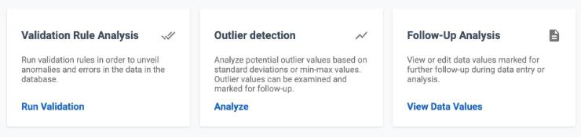

## Validation rule analysis { #validation_rule_analysis } 

### About validation rule analysis

A validation rule is based on an expression that defines a numeric relationship
between data element values. The expression forms a condition. The condition
checks that certain logical criteria are met.

The expression consists of:

  - a left side

  - a right side

  - an operator

A validation rule can assert that "Suspected malaria cases tested" \>=
"Confirmed malaria cases".

The left and right sides must return numeric values.

The validation rule analysis tests validation rules against the data
registered in the system. The analysis reports a validation violation when the
condition in the validation rule expression is not met, that is, when the
condition is false.

You can configure a validation rule analysis to send out
information about validation violations to selected user groups
automatically. These messages are called *validation notifications*. You create
them in the **Metadata Management** app. See [Create or edit a validation notification](#mm_create_validation_notification). DHIS2 sends validation notifications through
the internal messaging system.

> **Note**
>
> If your instance does not have the **Metadata Management** app, use the **Maintenance** app instead. You can create the same objects there.

### Workflow

1.  In the **Metadata Management** app, create validation rules and validation
    rule groups.

2.  (Optional) In the **Metadata Management** app, create validation
    notifications.

3.  Run the validation rule analysis, either automatically or manually.

      - In the **Scheduler** app, you schedule the validation
        rule analysis to run automatically for all validation rules
        included in one or several validation rule groups. After the
        system runs the analysis, you see the validation
        violations (if any) in the validation notifications that DHIS2 sends
        through the internal messaging system.

      - In the **Data Quality** app, you run the validation rule
        analysis manually for selected validation rules. After the
        analysis finishes, you see a list of validation
        violations (if any).

### Schedule a validation rule analysis to run automatically

> **Note**
>
> The validation rule analysis includes only validation rules that are part of
> one or several validation notifications. If a validation rule has no
> corresponding validation notification, DHIS2 sends no notification.

> **Note**
>
> When the validation rule analysis runs automatically, DHIS2 persists any
> results that are not yet persisted during this run. You can currently access
> persisted results only through the API. Consult
> the developers guide for more information about how to access persisted
> validation rule violations.

1.  Make sure that you have created all the validation rules, validation
    rule groups, and validation notifications that you need.

2.  Open the **Scheduler** app and click **New job**.

3.  Enter a **Name** for the new job.

4.  In the **Job type** drop-down menu, choose **Monitoring**. 

5.  Set a running frequency for the job, that is, when and how often the job runs. Enter a **CRON Expression**, or use **Choose from preset times**.

6.  Complete the **Parameters** section: **Relative start**, **Relative end**, **Validation rule groups**, **Send notifications** and **Persist results**.

7.  Click **Save** to confirm the job creation. For more information on adding jobs, see [Scheduling](data-administration.html#scheduling).

### Run a validation rule analysis manually

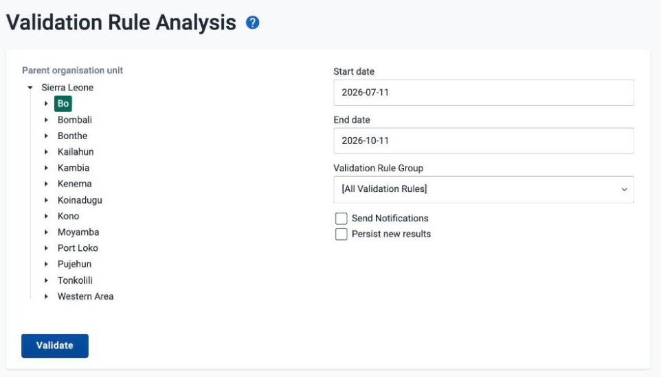

1.  Make sure that you have created all the validation rules, validation
    rule groups, and validation notifications that you need.

2.  Open the **Data Quality** app and click **Validation Rule
    Analysis**.

3.  Set **Start date** and **End date**.

    By default, the dates cover the last three months, from three months before today to today.

4.  Choose which **Validation Rule Group** you want to include in the
    analysis.

    You can choose all validation rules or all validation rules from a
    single validation rule group.

5.  (Optional) Choose **Send Notifications** to trigger validation
    notifications.

    > **Note**
    >
    > If you want to send out validation notifications, you must first
    > create them in the **Metadata Management** app.

6.  (Optional) Choose **Persist new results** to persist any non-persisted
    results found during the analysis.

7.  Choose a **Parent organisation unit**.

8.  Click **Validate**.

    **Validate** stays disabled until you choose an organisation unit and set a start date that is before the end date.

    The analysis duration depends on the amount of data that DHIS2
    analyzes. If there are no violations of the validation rules,
    you see the message **Validation passed successfully**. If
    there are validation violations, DHIS2 replaces the form with a list of them. Click the back arrow next to the page title to return to the form.

    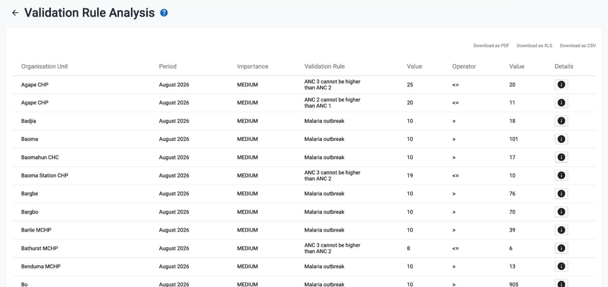

    The list shows the organisation unit, period, importance, validation rule, the values on the left and right sides, and the operator. If a violation involves a non-default attribute option combination, the list also shows an **Attr. Opt. Combo** column.

    If DHIS2 finds more violations than the app can show, a message at the top of the list says so, for example "More than 500 values found, please narrow the search to see all". Choose a shorter period or a smaller organisation unit and run the analysis again.

9.  (Optional) Click the information icon in the **Details** column to get more information about
    a validation violation.

    The **Validation Details** window shows the validation rule (its name and description), and the data elements and values on the **Left side** and the **Right side** of the rule. Use this information to identify
    the source of the violation.

    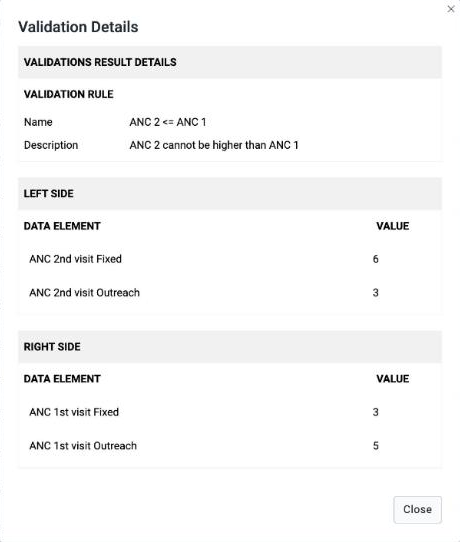

10. (Optional) Click **Download as PDF**, **Download as XLS** or
    **Download as CSV** to download the validation violations list in
    PDF, Excel, or CSV format.

## Outlier detection { #outlier_detection } 

### About outlier detection

The outlier detection tool identifies values that are
numerically distant from the rest of the data. These values might be outliers.
The analysis is based on the standard normal distribution. DHIS2 calculates the mean of
all values for an organisation unit, data element, category option
combination, and attribute option combination.

> **Note**
>
>  This data quality analysis is appropriate only for 
>  data that is normally distributed. Data with large seasonal
>  variation, or data that follows other statistical models
>  (for example, logistic) might cause the analysis to flag values that are actually valid. 
>  It is recommended that you first confirm whether the data actually is normally 
>  distributed before you run a standard deviation outlier analysis.

### Run outlier detection

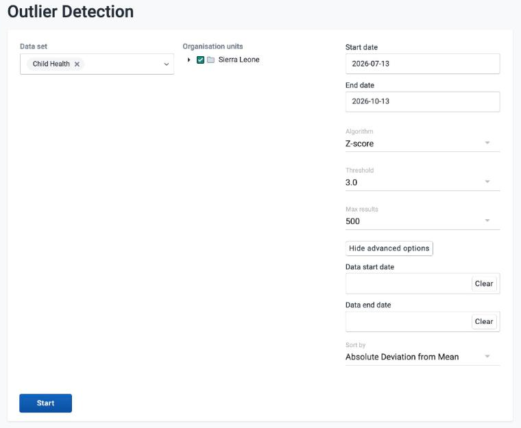

1.  Open the **Data Quality** app and click **Outlier detection**.

2.  Choose one or more data sets.

3.  Choose **Organisation units**.

    You can choose multiple organisation units. The analysis is made on raw data for all organisation units in the sub-hierarchy of the selected units, not on aggregated data.

4.  Set **Start date** and **End date**.

    By default, the dates cover the last three months, from three months before today to today.

5.  Set the **Algorithm** to use.

    The available algorithms are **Z-score** (based on the mean of data values), **Modified Z-score** (based on the median of data values), and **Min-max values** (based on stored min-max data values). The default is **Z-score**.

6.  Choose a **Threshold**.

    You can choose a value from 1.0 to 5.0 in steps of 0.5. The default is 3.0. For the **Z-score** algorithm, this is the number of standard deviations that the data can deviate from the mean before DHIS2 classifies it as an outlier. A higher threshold finds fewer outliers.

7.  Choose **Max results**.

    This is the maximum number of outliers in the results list. You can choose 100, 200, or 500. The default is 500.

8.  (Optional) Click **Show advanced options**, then set a **Data start date** and **Data end date**.

    Use these fields to run the outlier detection analysis on a subset of the data within the provided date range. When you leave them blank, DHIS2 uses the natural start and end date of the data set. Click **Clear** to remove a date. Click **Hide advanced options** to hide the fields again.

9.  (Optional) In the advanced options, choose a measure to **Sort by**.

    For **Z-score**, you can sort the outliers by **Z-score** or by **Absolute Deviation from Mean**. For **Modified Z-score**, you can sort by **Modified Z-score** or by **Absolute Deviation from Median**. The default is the absolute deviation.

    The advanced options are available for **Z-score** and **Modified Z-score**. The **Min-max values** algorithm does not have them.

10. Click **Start**.

    **Start** stays disabled until you choose a data set and an organisation unit, and set a start date that is before the end date.

    The analysis duration depends on the amount of data that DHIS2 analyzes. If the analysis finds outliers, DHIS2 replaces the form with a list of them. Click the back arrow next to the page title to return to the form.

    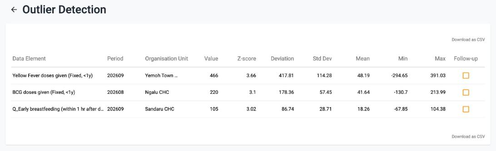

    For each outlier, the list shows the data element, period, organisation unit, value, Z-score, deviation, standard deviation, mean, min, and max. The minimum and maximum values are the border values that DHIS2 derives from the number of standard deviations that you chose for the analysis.

    With the **Modified Z-score** algorithm, the list shows **Modified Z-score** and **Median** columns instead of **Z-score** and **Mean**.

    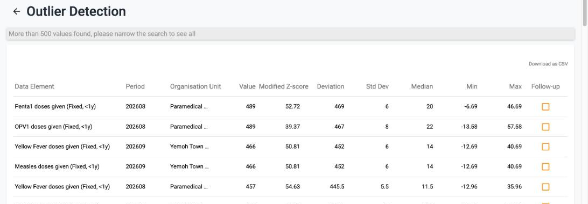

    If there are more outliers than the app can show, a message at the top of the list says so, for example "More than 500 values found, please narrow the search to see all". Choose a shorter period, fewer organisation units, or a higher threshold and run the analysis again.

11. (Optional) Click **Download as CSV** to download the list in CSV format.

> **Tip**
>
> Choose the checkbox in the **Follow-up** column to mark an outlier value for further follow-up. DHIS2 shows the message **Marked for follow-up**.

## Minimum maximum outlier detection { #min_max_outlier_detection } 

### About minimum maximum value based outlier detection

You can verify the data quality at the point of data entry by setting a
minimum/maximum value range for each data value. You can define the value
ranges manually or generate them automatically.

The auto-generated minimum maximum value range is suitable only for
normally distributed data. DHIS2 determines the arithmetic mean and
standard deviation of all values for a given data element, category
option, organisation unit, and attribute combination. Then the system
calculates the minimum maximum value range based on the **Data
analysis std dev factor** that you specify in the **System Settings** app.

For data that is highly skewed or zero inflated (as is often the case
with aggregate data), the values that DHIS2 generates automatically might not
provide an accurate minimum maximum value range. This can lead to
too many false violations, for example if you analyze values related to
seasonal diseases.

> **Note**
>
> DHIS2 calculates minimum maximum value ranges across all attribute
> combination options for a given combination of data element, category option,
> and organisation unit.

### Workflow

1.  Create a minimum maximum value range, either automatically or
    manually.

      - In the **Data Administration** app, you generate value ranges
        automatically.

      - In the **Data Entry** app, you can set value ranges manually. See [Minimum and maximum limits](#aggregate_data_entry_app.limits).

2.  In the **Data Quality** app, run **Outlier detection** with the **Min-max values** algorithm.

### Configure a minimum maximum outlier detection

#### Create minimum maximum value range automatically

> **Note**
>
> Auto-generated minimum maximum value ranges can be useful for many
> situations, but it is recommended that you verify that the data is actually
> normally distributed before you use this function.

You generate minimum maximum value ranges, calculated by data set, in the
**Data Administration** app. The new value ranges replace any value
ranges that the system calculated previously.

1.  Set the **Data analysis std dev factor**:

    1.  Open the **System Settings** app and click **General**.

    2.  In the **Data analysis std dev factor** field, enter a value.

        This sets the number of standard deviations to use in the
        outlier analysis. The default value is 2. Higher values
        indicate a broader distribution, which might cause the
        analysis to not flag outliers correctly. 

2.  Open the **Data Administration** app and click **Min-Max Value Generation**.

3.  Choose one or more data sets.

4.  Choose an **Organisation unit**.

5.  Click **Generate min-max values**.

    DHIS2 generates new minimum maximum value ranges for all data elements in the
    selected data sets for all organisation units (including
    descendants) of the selected organisation units.

#### Create minimum maximum value range manually

To set a minimum maximum value range for a single data value, use the **Data Entry** app. For the steps, see [Minimum and maximum limits](#aggregate_data_entry_app.limits).

#### Delete minimum maximum value range

You can permanently delete all minimum maximum value ranges for selected
data sets and organisation units in the **Data Administration** app.

1.  Open the **Data Administration** app and click **Min-Max Value Generation**.

2.  Choose one or more data sets.

3.  Choose an **Organisation unit**. The selection cascades to 
    descendant organisation units.

4.  Click **Remove min-max values**.

### Run a minimum maximum outlier detection

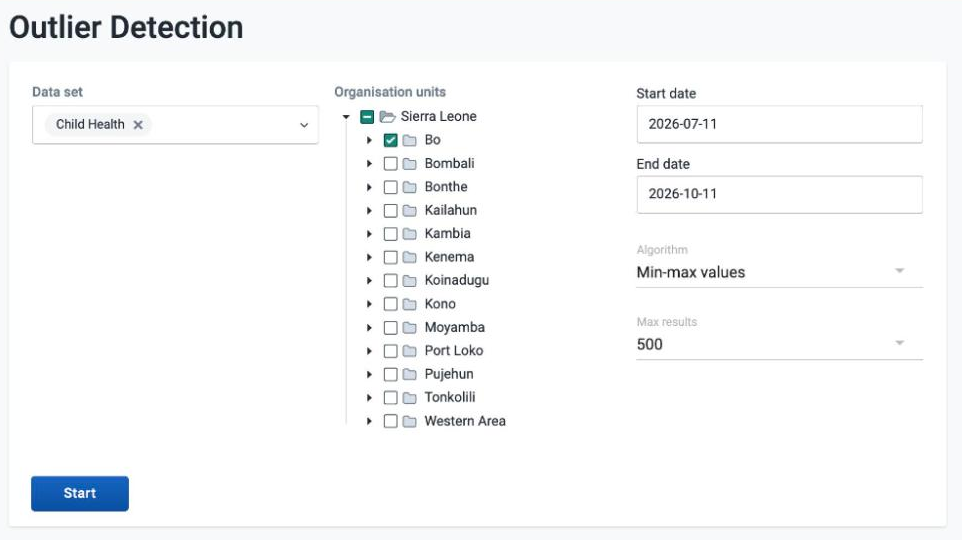

1.  Make sure that you have created minimum maximum value ranges.

2.  Open the **Data Quality** app and click **Outlier detection**.

3.  Choose one or more data sets.

4.  Choose **Organisation units**.

    You can choose multiple organisation units. The analysis is made on raw data for all organisation units in the sub-hierarchy of the selected units, not on aggregated data.

5.  Set **Start date** and **End date**.

6.  Set **Algorithm** to **Min-max values**.

    This algorithm has no **Threshold** and no advanced options.

7.  Choose **Max results**.

    This is the maximum number of outliers in the results list. You can choose 100, 200, or 500.

8.  Click **Start**.

    The analysis duration depends on the amount of data that
    DHIS2 analyzes. If the analysis finds outliers, DHIS2 shows them
    in a list.

    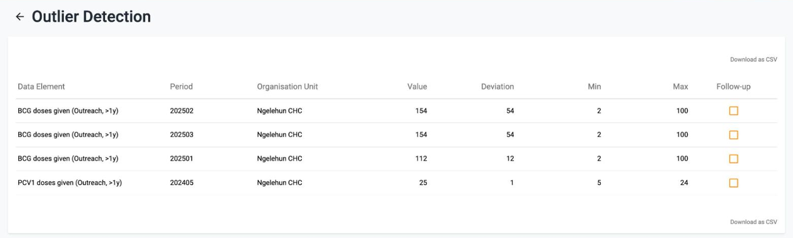

    For each outlier, the list shows the data element, period, organisation unit,
    value, deviation, min, and max.

9.  (Optional) Click **Download as CSV** to download the list in CSV format.

> **Tip**
>
> Choose the checkbox in the **Follow-up** column to mark the value for further follow-up.

## Follow-up analysis { #follow_up_analysis } 

### About follow-up analysis

The follow-up analysis creates a list of all data values marked for
follow-up. You can mark a data value for follow-up in the **Data Entry**
app and in the result list of a standard deviation outlier analysis or a
minimum maximum outlier analysis.

### Create list of data values marked for follow-up

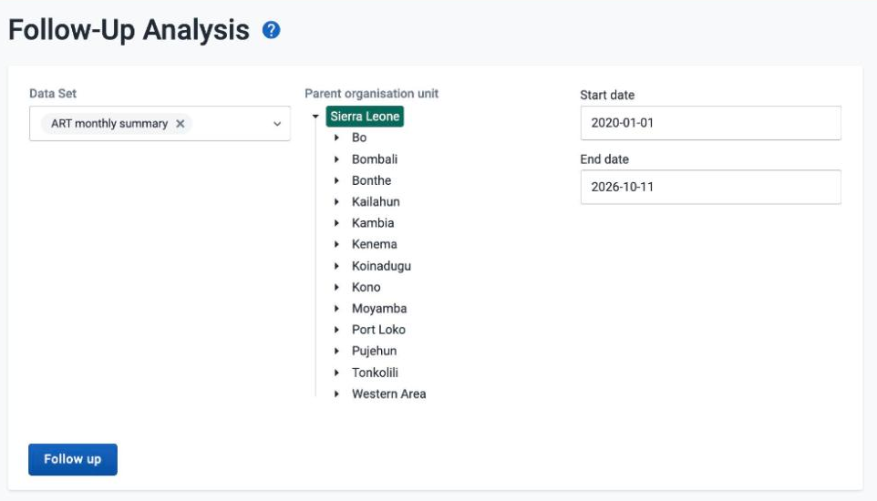

1.  Open the **Data Quality** app and click **Follow-Up Analysis**.

2.  Choose a data set.

3.  Choose the **Parent organisation unit**.

    The analysis is made on raw data "under" the organisation unit, not on aggregated data.

4.  Set a **Start date** and **End date** to define the periods in which you want to look for values that are marked for follow-up.

    By default, the dates cover the last three months, from three months before today to today.

5.  Click **Follow up** to generate a list of values that are marked for follow-up.

    **Follow up** stays disabled until you choose a data set and an organisation unit, and set a start date that is before the end date.

    The list shows the data element, organisation unit, period, min, value, max, an **Unfollow** checkbox, and a **Comment** column.

6.  (Optional) Click **Download as PDF**, **Download as XLS** or **Download as CSV** to download the follow-up list in PDF, Excel, or CSV format.

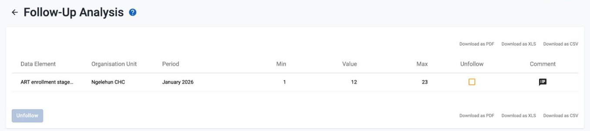

> **Tip**
>
> Choose the **Unfollow** checkbox in the list and click **Unfollow** to remove the follow-up tags from the marked data values. DHIS2 shows the message **Elements unfollowed** and removes the values from the list.
> If a value has a comment, click the icon in the **Comment** column to read it.
